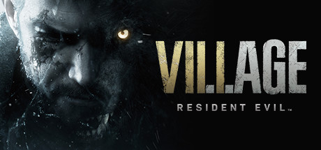

**Resident Evil Village is a first-person survival horror game continuing Ethan Winters' nightmare in a mysterious European village. Features four distinct horror environments, intense combat against grotesque enemies, and one of the series' most memorable antagonists.**

---

## 📖 About

Resident Evil Village is a first-person survival horror game continuing Ethan Winters' nightmare in a mysterious European village. Features four distinct horror environments, intense combat against grotesque enemies, and one of the series' most memorable antagonists.

## ⚠️ Problems Without Trainer

| Problem | Status |
|---------|--------|
| **Resource Scarcity** — Ammo is deliberately limited; poor shooting accuracy is heavily punished | ✅ Solved |
| **Mercenaries Grind** — Getting S+ rank on all Mercenaries stages requires near-perfect play | ✅ Solved |
| **Village of Shadows** — Highest difficulty removes saves and dramatically increases enemy health | ✅ Solved |
| **Boss Pattern Memory** — Some bosses require several attempts to learn complete pattern sequences | ✅ Solved |

## ✅ Solution

The **Resident Evil Village Trainer** solves all these issues by giving you complete control over the game.

## 🎯 Full Feature List

- Unlimited Resources
- God Mode / Invincibility
- Instant Skill Cooldown
- One-Hit Kill
- Freeze Game Timer
- Unlock All Items & Achievements
- Custom Speed Multiplier
- Save State Anywhere

## 🚀 Quick Start

1. **Disable Windows Defender** temporarily (trainer may trigger false positive)
2. Download the trainer from the button above
3. Launch Resident Evil Village
4. Run the trainer as Administrator
5. Activate desired cheats with hotkeys

## 💎 Free vs Paid

| Feature | Free | Pro |
|---------|------|-----|
| Basic God Mode | ✅ | ✅ |
| Unlimited Resources | ✅ | ✅ |
| All Advanced Cheats | ❌ | ✅ |
| Auto-Updates | ❌ | ✅ |
| Priority Support | ❌ | ✅ |

## 💻 Requirements

- Windows 10/11 (64-bit)
- Resident Evil Village (any version)
- .NET Framework 4.8+
- DirectX 11+

## 🍎 macOS

macOS users can use our alternative tool:

## ⚖️ Legal

This trainer is for educational and single-player use only. Use responsibly.

---

